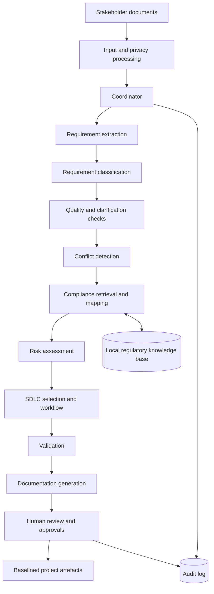

# PharmaReq AI

**Agentic AI for Requirement Gathering, Analysis, and SDLC Selection in Pharmacy Dispensing and Inventory Compliance**

PharmaReq AI is a prototype requirement-engineering assistant for pharmacy software projects. It analyses stakeholder documents, extracts and classifies software requirements, identifies ambiguity and conflicts, retrieves potentially relevant pharmacy regulatory information, assesses risks, recommends a suitable Software Development Life Cycle (SDLC) approach, and generates requirement-engineering artefacts for human review.

> **Project scope and safety:** PharmaReq AI supports software requirement engineering. It does not dispense medicines, provide clinical or dosing advice, or make final legal or regulatory determinations. Regulatory mappings are suggestions and must be checked against current official sources and approved by qualified people. Use synthetic or fully anonymised data only.

---

## Table of contents

- [Problem statement](#problem-statement)
- [Key features](#key-features)
- [System workflow](#system-workflow)
- [Architecture and technology](#architecture-and-technology)
- [Project structure](#project-structure)
- [Getting started](#getting-started)
- [Running the application](#running-the-application)
- [Using the web interface](#using-the-web-interface)
- [Command-line usage](#command-line-usage)
- [Generated outputs](#generated-outputs)
- [Evaluation and tests](#evaluation-and-tests)
- [Security and privacy](#security-and-privacy)
- [Known limitations](#known-limitations)
- [Future improvements](#future-improvements)

## Problem statement

Pharmacy software must support workflows such as prescription intake, dispensing, scheduled-drug record keeping, inventory and expiry management, billing, and audit preparation. Requirements for these systems come from multiple stakeholders and documents, and can be incomplete, ambiguous, inconsistent, or difficult to trace to applicable controls.

PharmaReq AI aims to assist the requirement-engineering process by converting stakeholder inputs into structured requirements and supporting artefacts, while retaining human review and approval for important decisions.

## Key features

- **Document-based requirement extraction:** Processes stakeholder interview notes, emails, inspector notes, and other plain-text inputs.
- **Requirement classification:** Organises extracted requirements into categories such as functional, security, privacy, regulatory, performance, auditability, and operational requirements.
- **Requirement quality analysis:** Flags ambiguity, incompleteness, undefined terms, missing sources, and testability issues.
- **Conflict detection:** Identifies possible duplicates, contradictions, numeric conflicts, and competing stakeholder expectations.
- **Clarification support:** Produces follow-up questions for requirements that need more information.
- **Retrieval-grounded compliance support:** Searches a local pharmacy knowledge base and attaches candidate regulatory references and control gaps.
- **Risk assessment:** Records risk likelihood, impact, rating, mitigation, and verification information.
- **SDLC recommendation:** Ranks candidate SDLC approaches using project factors and decision rules, and creates a project-specific workflow.
- **Documentation generation:** Produces an SRS, user stories, use cases, workflows, risk and compliance artefacts, and a traceability matrix.
- **Human-in-the-loop review:** Supports role-based requirement decisions, conflict resolution, SDLC sign-offs, and project baselining.
- **Audit trail:** Records important actions in a hash-chained audit log that can be checked for tampering.
- **Offline operation:** The application includes deterministic rule-based paths so the prototype can run without an LLM API key.

## System workflow



The coordinator manages the analysis pipeline. Some capabilities are implemented as specialised modules within the coordinated workflow rather than as independently deployed autonomous services.

## Architecture and technology

| Component | Technology / implementation |
|---|---|
| Main language | Python |
| Backend API | FastAPI |
| Web interface | HTML, CSS, JavaScript |
| Data validation | Pydantic |
| Database | SQLite |
| ASGI server | Uvicorn |
| Testing | Pytest |
| Knowledge retrieval | Local TF-IDF-based text retrieval |
| Optional language model | Google Gemini through the `google-genai` SDK |
| Audit logging | Hash-chained application audit log |

### Main agent and service modules

| Module | Responsibility |
|---|---|
| `agents/coordinator.py` | Orchestrates the requirement-analysis pipeline and approval workflow |
| `agents/extraction.py` | Extracts structured requirements from source documents |
| `agents/interview.py` | Conducts adaptive stakeholder interviews |
| `agents/classification.py` | Assigns requirement categories |
| `agents/quality.py` | Checks requirement quality and creates clarification questions |
| `agents/conflict.py` | Detects possible requirement conflicts |
| `agents/compliance.py` | Retrieves and maps candidate regulatory controls |
| `agents/risk.py` | Analyses project and requirement risks |
| `agents/sdlc.py` | Scores and ranks SDLC approaches and generates a workflow |
| `agents/validation.py` | Checks validation conditions and reports metrics |
| `agents/documentation.py` | Generates requirement-engineering documents |
| `kb/retriever.py` | Retrieves relevant entries from the local knowledge base |
| `privacy.py` | Applies sensitive-data masking and prompt-injection screening |
| `store.py` | Persists runs and handles approval-related state |
| `audit.py` | Writes and verifies audit events |
| `api.py` | Exposes the web application and REST API |

## Project structure

```text
pharmareq-ai/
├── config/
│   └── users.json
├── data/
│   └── samples/
│       ├── doctor_email.txt
│       ├── inspector_notes.txt
│       ├── owner_interview.txt
│       └── pharmacist_interview.txt
├── eval/
│   ├── evaluate.py
│   ├── feedback_form.md
│   └── gold.json
├── pharmareq/
│   ├── agents/
│   ├── kb/
│   │   ├── regulations.json
│   │   └── retriever.py
│   ├── web/
│   │   └── index.html
│   ├── api.py
│   ├── audit.py
│   ├── cli.py
│   ├── config.py
│   ├── llm.py
│   ├── privacy.py
│   ├── schemas.py
│   ├── store.py
│   └── text_utils.py
├── tests/
├── outputs/          # Generated run artefacts
├── var/              # Local SQLite database
├── .env.example
├── requirements.txt
└── README.md
```

## Getting started

### Prerequisites

- Python 3.10 or newer
- pip
- Git (if cloning the repository)

The application uses SQLite and does not require a separate database server.

### 1. Clone the repository

Replace `YOUR-USERNAME` with your GitHub username or the repository owner.

```bash
git clone https://github.com/YOUR-USERNAME/pharmareq-ai.git
cd pharmareq-ai
```

### 2. Create and activate a virtual environment

**Windows PowerShell**

```powershell
python -m venv .venv
.venv\Scripts\Activate.ps1
```

**Windows Command Prompt**

```bat
python -m venv .venv
.venv\Scripts\activate.bat
```

**macOS / Linux**

```bash
python3 -m venv .venv
source .venv/bin/activate
```

### 3. Install dependencies

```bash
python -m pip install --upgrade pip
pip install -r requirements.txt
```

### 4. Configure the application

Copy the example environment file:

**Windows PowerShell**

```powershell
Copy-Item .env.example .env
```

**macOS / Linux**

```bash
cp .env.example .env
```

The prototype can run in offline mode without an LLM API key:

```env
PHARMAREQ_MODE=offline
```

#### Optional Gemini integration

The current `pharmareq/llm.py` implementation uses Google Gemini and reads `GEMINI_API_KEY`. The Gemini SDK is not listed in the supplied `requirements.txt`, so install it separately if you want to enable this integration:

```bash
pip install google-genai
```

Add the following to your local `.env` file:

```env
GEMINI_API_KEY=YOUR_GEMINI_API_KEY
PHARMAREQ_MODE=auto
```

The current implementation calls the `gemini-2.5-flash` model. Do not commit `.env` or publish API keys. If the SDK, key, or model call is unavailable, the application is designed to fall back to its offline rule-based path.

> **Configuration note:** Check that `.env.example`, `config.py`, `llm.py`, and `requirements.txt` agree before publishing or distributing a release. The supplied project snapshot contains older Anthropic/Claude references in some configuration and documentation files, while `llm.py` currently imports Gemini.

## Running the application

From the project root, with the virtual environment activated:

```bash
python -m pharmareq.cli serve
```

Open the application in your browser:

```text
http://127.0.0.1:8000
```

FastAPI interactive API documentation is available at:

```text
http://127.0.0.1:8000/docs
```

Stop the local server with `Ctrl+C`.

## Using the web interface

1. Start the web application.
2. Sign in using one of the configured demo roles in `config/users.json`.
3. Load the supplied synthetic stakeholder samples or provide your own plain-text documents.
4. Start requirement analysis.
5. Review the extracted and classified requirements.
6. Inspect clarification questions, possible conflicts, compliance mappings, control gaps, and risk results.
7. Review the ranked SDLC recommendation and proposed workflow.
8. Use the configured roles to accept, reject, modify, or regenerate requirements where permitted.
9. Complete required sign-offs and resolve outstanding blockers.
10. Baseline the run when the required approvals and validation conditions are satisfied.
11. Review and download the generated artefacts and audit history.

The demo authentication uses static API keys configured in `config/users.json` and sent in the `X-API-Key` request header. These credentials are for local demonstration only and must not be treated as production authentication.

## Command-line usage

### Analyse the supplied sample documents

```bash
python -m pharmareq.cli run data/samples
```

### Analyse a text file

```bash
python -m pharmareq.cli run path/to/stakeholder_notes.txt
```

### Set project parameters

```bash
python -m pharmareq.cli run data/samples \
  --name "Retail Pharmacy System" \
  --months 4 \
  --team 5 \
  --availability 3 \
  --legacy 2 \
  --cd 3 \
  --budget 3
```

### Conduct an interactive stakeholder interview

```bash
python -m pharmareq.cli interview \
  --role Pharmacist \
  --out pharmacist_interview.txt
```

### Verify the audit hash chain

```bash
python -m pharmareq.cli verify-audit
```

Input documents are plain-text `.txt` files. A first line such as `# Stakeholder: Pharmacist` can identify the stakeholder. Speaker labels in the text can also be used to identify who provided a statement.

## Generated outputs

Each analysis run creates a directory under `outputs/<run-id>/`.

| Artefact | Description |
|---|---|
| `01_SRS.md` | Software Requirements Specification |
| `02_user_stories.md` | User stories and acceptance criteria |
| `03_use_cases.md` | Use-case descriptions |
| `04_workflows.md` | Process workflows and diagrams |
| `05_data_and_interfaces.md` | Data and interface requirements |
| `06_risk_register.md` | Identified risks and mitigation information |
| `07_compliance_matrix.md` | Candidate requirement-to-control mappings and gaps |
| `08_traceability_matrix.csv` | Traceability between source, requirement, control, risk, acceptance criteria, and test information |
| `09_assumptions_dependencies.md` | Assumptions and dependencies |
| `10_open_issues.md` | Unresolved questions and issues |
| `11_sdlc_recommendation.md` | Ranked SDLC recommendations and proposed workflow |
| `12_validation_report.md` | Validation results and metrics |
| `run.json` | Machine-readable run information |
| `index.md` | Run artefact index |

Generated documents remain drafts until the required human approvals and baseline process are completed.

## Evaluation and tests

Run the automated test suite:

```bash
python -m pytest -q tests
```

Run the evaluation script:

```bash
python eval/evaluate.py --manual-minutes 180
```

The evaluation directory contains:

- `gold.json`: A starter reference dataset based on the supplied sample documents.
- `evaluate.py`: Evaluation script.
- `feedback_form.md`: Template for collecting reviewer feedback.

The starter dataset is limited and should not be treated as proof of general accuracy. A stronger evaluation should include unseen stakeholder documents, independently reviewed reference requirements, ambiguous and conflicting examples, and feedback from pharmacy-domain reviewers.

## Security and privacy

- Use synthetic or fully anonymised documents for demonstrations and testing.
- Do not commit `.env`, API keys, passwords, patient data, or real prescription records.
- The application includes sensitive-data masking and prompt-injection screening, but these are safeguards rather than guarantees.
- Demo API-key authentication is not production-grade.
- The prototype does not implement multi-factor authentication, production TLS configuration, or encryption at rest for the SQLite database.
- Review API responses and configuration files before making a repository public. Never expose configured demo credentials or secrets.
- Regulatory outputs require verification and human approval.

## Known limitations

- Offline requirement extraction relies on deterministic, cue-based logic and may miss implicit requirements or extract irrelevant statements.
- The optional LLM integration is used as an enhancement; its output must still be checked and can fall back to offline processing.
- Knowledge retrieval uses a local TF-IDF-based text index over the supplied regulation summaries. It is not a production vector database.
- The regulation knowledge base contains prototype summaries. Entries are marked unverified and must be checked against current official sources.
- Demo authentication uses static API keys.
- Multi-factor authentication, production TLS, and encryption at rest are not implemented.
- Some responsibilities are implemented inside shared modules rather than as separate autonomous agents or services.
- Hospital indent-and-issue and e-pharmacy workflows are not implemented as complete modules.
- The system is an advisory requirement-engineering prototype, not a pharmacy operations or clinical decision-support product.

## Future improvements

Potential extensions include:

- Verify and version regulatory content using official sources.
- Expand the knowledge base with jurisdiction, applicability, effective date, and source metadata.
- Add a vector database for larger document collections.
- Improve extraction and clarification using a validated LLM workflow.
- Add stronger authentication, authorisation, encryption, and deployment controls.
- Expand test datasets and evaluate against independently annotated requirements.
- Add further pharmacy workflows after validating the initial scope.

