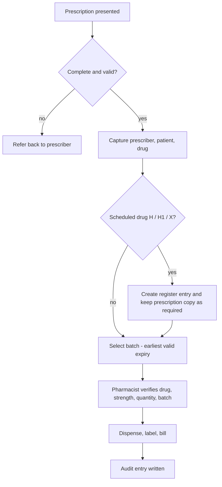
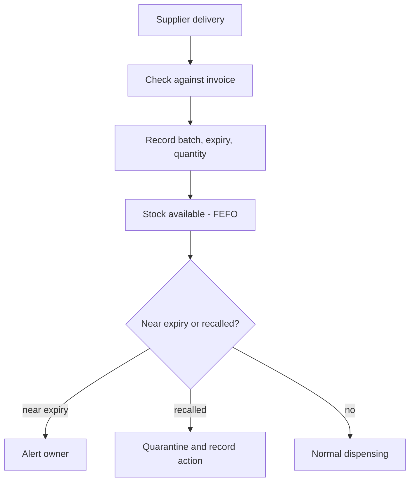

# Process workflows

> **DRAFT** - AI-assisted output. Not approved. Regulatory mappings are candidate mappings for a qualified pharmacist or compliance officer to confirm.

## Prescription to dispensing

## Goods receipt to stock

